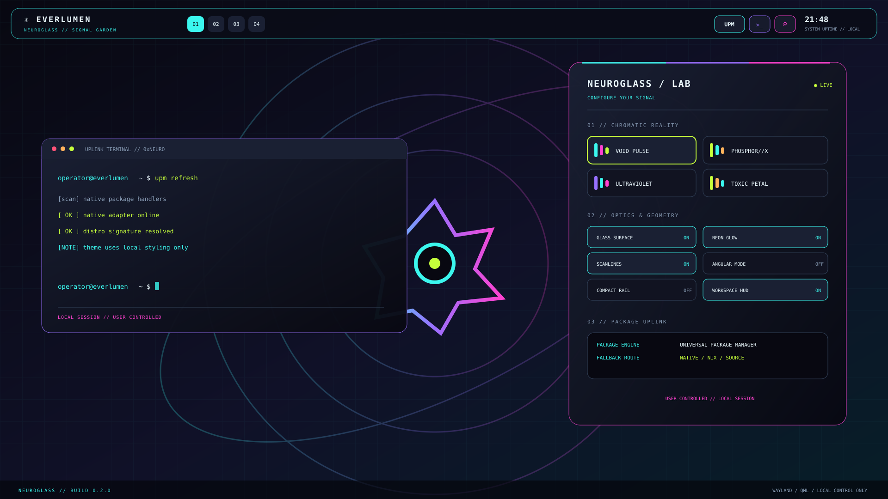

# EVERLUMEN // NEUROGLASS

A cyberpunk glass-shell for Hyprland powered by Quickshell: neon HUD, live workspaces, an interactive visual lab, and UPM-aware dependency setup.

The visual system combines blacklight bioglass, phosphor-cyan signal lines, acid-lime highlights, ultraviolet haze, magenta glitch traces, and prismatic geometry. This is a theme kit, not a new Linux distribution.

## Quick start

    git clone https://github.com/arc2898/Linux.git
    cd Linux/themes/everlumen
    chmod +x install.sh scripts/*.sh
    ./install.sh --check
    ./install.sh

Launch with everlumen-start or qs -c everlumen. Run everlumen-doctor to inspect your OS family, Hyprland, Quickshell, UPM, terminal, portals, clipboard, screenshot, audio and brightness utilities.

## Installer options

- ./install.sh --check — strict dependency report.
- ./install.sh --deps — offer Quickshell install via UPM where safe, then the native package manager.
- ./install.sh --deps --extras — additionally offer optional GUI utilities.
- ./install.sh --deps --install-hyprland — explicitly allow an attempt to install Hyprland itself.
- ./install.sh --bootstrap-upm — build the actual upstream UPM project; Go is required.
- ./install.sh --bootstrap-upm --install-go — also allow offering a native Go installation.
- ./install.sh --enable — back up and opt an existing Hyprland config into the theme.

System package operations never run by default. Hyprland is never installed unless --install-hyprland is explicit. On Arch, the installer bypasses UPM's current Pacman adapter and uses a full pacman -Syu --needed transaction, avoiding a partial-upgrade workflow. If Quickshell is unavailable from configured repositories, the fallback offers a Nix profile install or a user-local source-build attempt.

## Included
- Quickshell HUD with live Hyprland workspaces, terminal/app launcher/UPM actions, and a customizable Neuroglass Lab.
- Four profiles: Void Pulse, Phosphor//X, Ultraviolet, Toxic Petal.
- Current-style Hyprland Lua and legacy hyprlang fragments.
- Kitty, GTK, Rofi, Neovim and UPM-terminal styling.
- SVG wallpaper, preview and organism mark; local wallpaper renderer.
- Distro/dependency checker, UPM bootstrapper, native fallback, Quickshell fallback, installer smoke tests and troubleshooting notes.

## Notes
Quickshell 0.3.x is the target. QML must still be tested against the installed Qt and Quickshell build. Visual lab changes last for the current shell session; persistent GUI preference storage is not claimed. The preview is concept art, not a screenshot from a live desktop. The project aims for a distinctive implementation; no one can verify that no similar aesthetic has ever existed.

See docs/INSTALLER.md, docs/TROUBLESHOOTING.md, and docs/RESOURCES.md. MIT license.
